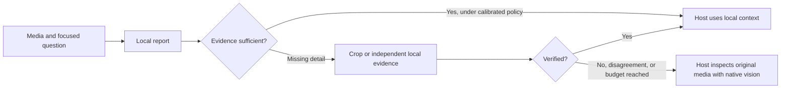

# Measuring perception parity and deciding when to escalate

This is an evaluation and routing proposal, not a claim that local models match the hosted models.
The [CLI comparison suite](benchmark-cli.md) supports Ollama, Omni, native Codex and Claude Code
vision, with live progress, deterministic correctness and estimated costs. Direct hosted API adapters,
consensus execution, paired confidence intervals and automatic native-review routing remain future work.

## Establish the comparison

Keep two separate evaluations:

1. **Perception:** give each model the same image bytes, question and output schema. Record crops,
   resizing, image-detail settings, output limits, reasoning settings and model versions. This
   measures the visual worker without giving one side extra evidence or tool access.
2. **Agent task success:** compare the same host agent using its native vision, using only a local
   report, and using a local-first workflow with escalation. Give every workflow the same task,
   original media and budget. Native vision may use its normal resolution and crop tools here.
   Score the final task outcome, including errors caused by information lost in the local report.

Do not treat a hosted answer as ground truth. Use labeled tasks, exact visible strings, generated
scene specifications or human verification. Blind human/LLM graders to model names, audit their
disagreements, and distinguish semantic correctness from JSON/format compliance. The existing
strict JSON scorer intentionally treats malformed answers as failures; that alone does not prove
the model failed to perceive the media.

Candidate hosted model IDs verified in official documentation on 2026-10-18:
`claude-opus-5-5`, `claude-fable-5-1`, `gpt-6.1-sol`, and `gpt-6-astra`. Record the actual returned
model/version and settings for every run. API and Claude Code/Codex harness results belong in
separate groups: their system prompts, tool access, image preprocessing and reasoning budgets
can differ. Account access must be checked before running; a documented model is not proof that
the current account can call it.

## Dataset and acceptance gates

Use a development set for prompts and routing thresholds, then freeze a held-out test set. Start
with 300–1,000 unique scenes from actual workflows, with deliberate difficult and absent-evidence
cases. Expand categories where the confidence interval is too wide. Repeated prompts, crops of the
same screenshot and nearby video frames do not count as independent scenes.

| Workload | Ground truth / checks |
| --- | --- |
| UI screenshots and OCR | Exact error codes, small text, numbers, buttons and missing elements |
| Layout and grounding | Bounding boxes, relationships, target coordinates and final action success |
| Charts and diagrams | Correct values, units, connections, legends and spatial reasoning |
| Image changes | Meaningful differences, occlusion and visually similar distractors |
| Sampled video | Events, ordering, timestamps, and brief events missed between sampled frames |
| Uncertainty | Unreadable text, absent objects, contradictory evidence and appropriate abstention |
| Embedded instructions | Whether media content hijacks the task or induces unauthorized actions |

For video perception comparisons use identical selected frames and timestamps. Separately compare
the full workflows with their normal frame-search strategies; sparse sampling can miss events
regardless of model quality.

Define acceptable loss before seeing results. An example starting policy is at most two percentage
points lower task success than each named native baseline, with a paired 95% confidence interval
whose lower bound stays above that margin. Report every category and each native baseline
separately. Bootstrap by source scene, not request row. A deployment threshold such as 90% accuracy
is not itself a parity test, and a nonsignificant difference does not establish equivalence.

Also gate hallucinated critical details, wrong-click risk, and error rate among answers accepted
without native review. As a useful scale check, zero errors in 300 independent accepted cases only
places the approximate one-sided 95% upper error bound near 1%; it does not prove zero risk or that
every category has that bound. Use more evidence or mandatory review for stricter tasks.

Measure coverage alongside accepted-answer error: a system that escalates everything can look
accurate while saving nothing. Include p50/p95 end-to-end latency, queue delay, cold/warm starts,
host context tokens, GPU/RAM use, cost per successful task and fallback frequency. Count all
verification, consensus, retries and hosted calls. Prespecify task and retry budgets.

## Consensus and native fallback

Compare these policies as separate experimental arms:

- One local model answering from the ordinary image.
- One local model with targeted crop/reinspection when detail is missing.
- Independent local evidence from different models or complementary specialists, with a verifier.
- Local-first inspection followed by native host vision when verification fails.
- Native host vision throughout, as the baseline.

Ask local readers independently before showing them each other's answers. Compare structured claims
and their evidence regions, not prose similarity. Crops, OCR and alternative frame selections may
add more evidence than another agent reasoning about the same compressed report. Multiple host
agents sharing one local worker are concurrency clients, not independent visual models.

Agreement is a routing feature, not proof. Same-model votes can share hallucinations; different
models can also share blind spots. Test whether agreement predicts correctness on held-out data.
Calibrate any confidence threshold from observed errors; do not trust a self-reported confidence
number by itself. On one GPU, extra readers can increase queueing and model reload costs.



Use bounded escalation: for example, one local attempt, one targeted verification, then native
review. Exact critical identifiers, tiny/unreadable text, grounding uncertainty, missing coverage,
contradictory claims and invalid reports can trigger review. Confident local errors must also be
sampled in evaluation so escalation is not measured only on failures the local model admits.

The native reviewer needs the original image or relevant crops/frames, not just the local summary.
Have it inspect independently before reconciling local claims to reduce anchoring. Return a concise
context packet containing media hash, model, crops/timestamps, claims, supporting evidence and
unresolved questions. `needs_native_review` would be a useful future machine-readable signal;
it is not currently a field returned by local-vision.

For Codex/Claude Code, the host can use its own native vision for fallback, without storing hosted
API keys in local-vision. A future server-managed provider fallback would be a separate explicit
integration with provider access, media-sharing policy and spend limits. No automatic upload or
provider fallback has been enabled by installing this MCP server.

## Audio and music need their own evaluation

The four named reasoning models support images but do not expose raw audio input on their cited
model APIs. Thus there is no direct native-audio parity baseline against those same endpoints.
An agent that reads a transcript can reason about the transcript; it cannot recover nonverbal
details removed from it. Dedicated hosted audio models and audio-capable services are separate
baselines, and their music capability still needs task-specific testing.

For speech measure word/character error rate, names/numbers, timing, speakers and noisy speech.
For sound events measure event accuracy, timing, counts and false positives on silence/absence.
For music measure tempo with annotated half/double-time ambiguity, beat alignment, key/chord
estimation with tolerances, instruments, vocal presence and blinded caption quality. Use MIDI,
stems, annotated recordings and human review rather than an API model's description as truth.
Pair Omni with task-specific ASR/DSP evidence where useful; multiple text agents cannot reconstruct
audio details that no audio worker actually perceived. Local audio capability may add modality
coverage, but the present diagnostic results do not establish production quality or API parity.

## What can run now

The existing local benchmark does not download models. Use a fresh output directory each time:

```bash
uv sync --locked --extra bench
uv run local-vision-bench fixtures --output benchmarks/generated/parity-pilot --variants 3
uv run local-vision-bench run \
  --manifest benchmarks/generated/parity-pilot/manifest.json \
  --models qwen3.5:2b qwen3.5:4b --agents 1 --workers 1 --repeats 3 \
  --output benchmarks/results/parity-local-pilot
```

This is a local diagnostic, not the held-out native comparison. `--agents 1,4` tests client load;
it does not implement consensus. Audio can be evaluated through an Omni matrix as described in
the README. Keep inference isolated or idle so benchmarks do not disrupt live client jobs.

The [native CLI comparison suite](benchmark-cli.md) now supports the same manifest, image-transform
provenance, model settings, live progress/cost/correctness, and per-category reports. Next steps are
direct API adapters, scene-paired statistical reports, and bounded consensus/fallback arms.
At installation time, neither `OPENAI_API_KEY` nor `ANTHROPIC_API_KEY` was set in the invoking shell.
Direct API benchmark runs have not been performed. Native CLI smoke tests on 2026-10-18 passed one
OCR case each through GPT 6.1 Sol and Claude Fable 5.1 with identical prepared-image hashes; Qwen
3.5 4B passed two local cases. These checks establish adapter connectivity, not perception parity.
Claude returned its resolved model; Codex did not expose a resolved model in the usage events.

References: [OpenAI evaluation guidance](https://developers.openai.com/api/docs/guides/evaluation-best-practices),
[GPT-6.1 Sol](https://developers.openai.com/api/docs/models/gpt-6.1-sol),
[GPT-6 Astra](https://developers.openai.com/api/docs/models/gpt-6-astra),
[Claude Opus 5.5](https://platform.claude.com/docs/en/models/opus-5-5/overview),
[Claude Fable 5.1](https://platform.claude.com/docs/en/models/fable-5-1/overview),
and [OpenAI audio APIs](https://developers.openai.com/api/docs/guides/audio).
